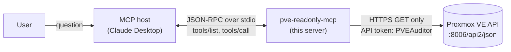

# pve-readonly-mcp

A small, **read-only** [Model Context Protocol](https://modelcontextprotocol.io) (MCP) server for
[Proxmox VE](https://www.proxmox.com/en/proxmox-virtual-environment). It lets an AI assistant such as
Claude answer typical admin questions about a Proxmox host — *"Is a storage running full?"*,
*"Which guests have no recent backup?"*, *"What failed this week?"* — without being able to change
anything.


## What is MCP?

MCP is an open standard that connects AI applications to external tools and data. An MCP **server**
(this project) exposes **tools** with a name, a description and a typed parameter schema. An MCP
**host** (e.g. Claude Desktop) starts the server, lists its tools and lets the model decide when to
call them. Communication uses JSON-RPC 2.0, here over `stdio`.



## Tools

- **`list_nodes`** — Are all nodes online? CPU, memory, uptime.
  API: `GET /nodes`
- **`list_guests(node?, status?)`** — Which VMs and containers exist, and are they running?
  API: `GET /cluster/resources?type=vm`
- **`get_guest_status(vmid)`** — Current CPU, memory and uptime of one guest.
  API: `GET /nodes/{node}/{type}/{vmid}/status/current`
- **`list_storage(node?)`** — Is a storage running full? Fullest first.
  API: `GET /cluster/resources?type=storage`
- **`list_failed_tasks(since_hours=168, limit=20)`** — What went wrong recently? Failed tasks and
  tasks with warnings, newest first.
  API: `GET /cluster/tasks`
- **`get_backup_status(max_age_hours=24)`** — Which guests have no backup younger than *n* hours?
  Problems first; unreachable backup storages are reported separately.
  API: `GET /nodes/{node}/storage?content=backup`, `GET /nodes/{node}/storage/{storage}/content?content=backup`
- **`list_snapshots(vmid)`** — Which (old) snapshots exist for a guest? Oldest first.
  API: `GET /nodes/{node}/{type}/{vmid}/snapshot`

In addition the server provides the MCP **prompt** `health_check`: a template that tells the model
to combine the tools above into a short health report (overall status, problems per area, next
steps).

All sizes are returned in GiB, percentages with one decimal, timestamps as ISO 8601 in UTC.

## Example

> **You:** Did any backups fail this week, and is any storage running full?
>
> *Claude calls `list_failed_tasks`, `get_backup_status` and `list_storage`.*
>
> **Claude:** One backup job failed: *vzdump* for VM 100 (win11) three hours ago with "job errors".
> Its newest backup is 3 days old. Container 101 (prometheus) was backed up 2 hours ago. The storages
> `pbs` and `nas` could not be checked. `local-lvm` is at 75 %, all other storages are below 30 %.

*(Example based on the test data. A screenshot from a real system will follow.)*

## Security model

The server is designed so that an AI assistant **cannot change anything**, with two independent
layers of protection:

1. **Code:** only HTTP `GET` requests exist in the code. There are no write endpoints. The tests
   additionally fail if any other HTTP method is used.
2. **Permissions:** the server authenticates with a Proxmox **API token** whose user only has the
   built-in role `PVEAuditor` (read-only). Even a bug in the code could not modify the cluster.

Further measures:

- Secrets are never part of the repository: configuration via environment variables or a local
  `.env` file (ignored by git, template: `.env.example`).
- TLS is verified. For the self-signed Proxmox certificate the Proxmox CA can be configured
  (`PVE_CA_FILE`) instead of disabling verification.
- Tool parameters are validated against their types (pydantic) before a tool runs. URL paths are
  built from API data and integer VMIDs only.
- The secret is stored in plain text in `.env` or the MCP host configuration. This is acceptable for a
  read-only token in a home lab; see *Possible extensions*.

## Setup

### 1. Create a read-only API token in Proxmox

On the Proxmox host:

```bash
pveum user add mcp@pve --comment "read-only MCP server"
pveum acl modify / --users mcp@pve --roles PVEAuditor
pveum user token add mcp@pve readonly --privsep 0
```

The last command prints the token secret once — store it safely. With `--privsep 0` the token
inherits the permissions of `mcp@pve` (only `PVEAuditor`).

Optional, for TLS verification: copy `/etc/pve/pve-root-ca.pem` from the host to your machine.

### 2. Install

Requires Python ≥ 3.11 and [uv](https://docs.astral.sh/uv/).

```powershell
git clone https://github.com/mrasdev/pve-readonly-mcp.git
cd pve-readonly-mcp
uv sync
Copy-Item .env.example .env   # then fill in your values
```

| Variable | Example | Required |
|---|---|---|
| `PVE_URL` | `https://pve.local:8006` | yes |
| `PVE_TOKEN_ID` | `mcp@pve!readonly` | yes |
| `PVE_TOKEN_SECRET` | `xxxxxxxx-xxxx-…` | yes |
| `PVE_CA_FILE` | `C:\path\to\pve-root-ca.pem` | no |

Environment variables take precedence over values in `.env`.

### 3. Connect to Claude Desktop

Add the server to `claude_desktop_config.json` (Claude Desktop → Settings → Developer → Edit Config):

```json
{
  "mcpServers": {
    "pve-readonly": {
      "command": "uv",
      "args": ["--directory", "C:\\path\\to\\pve-readonly-mcp", "run", "pve-readonly-mcp"]
    }
  }
}
```

Restart Claude Desktop. The tools appear in the tool menu of the chat.

To inspect the server without an AI, use the MCP Inspector:

```powershell
uv run mcp dev src/pve_readonly_mcp/server.py
```

## Development

```powershell
uv sync                    # install incl. dev dependencies
uv run pytest -v           # tests
uv run ruff check          # lint
uv run ruff format         # format
```

The tests run without a Proxmox host: `httpx.MockTransport` simulates the API (`tests/conftest.py`).
They cover the tools directly and via the MCP protocol (in-process client). GitHub Actions runs
lint, format check and tests on every push and pull request.

Project layout:

```
src/pve_readonly_mcp/
    config.py       settings from environment / .env
    pve_client.py   thin HTTP client for the Proxmox API (GET only)
    server.py       MCP tools and prompt
tests/              mocked API, tool tests, protocol tests
```

## Limitations

- The mocked API responses are based on the Proxmox API documentation. Field names have to be
  verified against a real host (`pvesh get <path> --output-format json`).
- `get_backup_status` evaluates backup files on the storages. Backups on storages that are inactive or
  return an error are reported in `unreachable_storages`, not silently ignored.
- `list_failed_tasks` only sees the task history Proxmox keeps (recent tasks).

## Possible extensions

- Store the token secret in the OS credential store (`keyring`) instead of plain text.
- Configurable thresholds for the `health_check` prompt.
- Support for multiple Proxmox clusters.

## License

[MIT](LICENSE)
